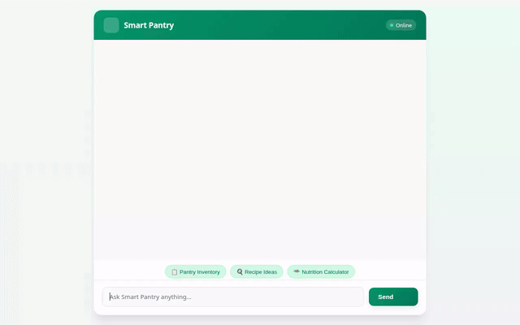

# Smart Pantry - AI Kitchen & Inventory Assistant



Smart Pantry is an intelligent AI kitchen assistant built with the **Google Agent Development Kit (ADK)**. It helps home cooks track pantry inventory, discover personalized recipes based on available ingredients, visualize dishes with generative AI, create short video clips of food items, and locate nearby supermarkets to buy missing ingredients.

---

## 🌟 Implemented Features & Google Cloud Services

Smart Pantry integrates several Google Cloud services and Vertex AI models to deliver a seamless multimodal experience:

- **Vertex AI Memory Bank**
  - Uses `PreloadMemoryTool` and custom memory-generation callbacks (`save_session_memories`) to persist long-term user dietary preferences, allergies, and cooking habits across sessions.

- **Google Cloud Firestore**
  - Manages real-time pantry inventory in Firestore (`pantry_items` collection).
  - Tools implemented: `list_pantry_items`, `add_pantry_item`, `update_pantry_item`, and `remove_pantry_item`.

- **Vertex AI Image Generation (`gemini-3.1-flash-lite-image`)**
  - Generates realistic, appetizing visuals of suggested dishes via `generate_item_image`.
  - Automatically uploads generated images to Google Cloud Storage.

- **Vertex AI Omni Video Generation (`gemini-omni-flash-preview`)**
  - Generates short video clips for pantry items or dishes using Google's Omni model in the `global` region (`generate_item_video`).
  - Saves video artifacts to the Playground panel and uploads MP4 files to Google Cloud Storage.

- **Google Cloud Storage (GCS)**
  - Serves as the public media repository for generated images and video clips.

- **Google Places & Geocoding API**
  - Translates location addresses into geographic coordinates (`geocode_address`) and finds nearby grocery stores and supermarkets (`find_nearby_places`).

- **Recipe Intelligence**
  - Recommends tailored recipes matching current pantry stock (`suggest_recipes`).

- **Agent-to-User Interface (A2UI)**
  - Emits rich display cards for structured responses in supported web user interfaces.

---

## 🚧 Planned / Not Yet Implemented Features

The following features were outlined during initial brainstorming but are not yet implemented in the current code release:

- 📷 **Camera / Barcode Receipt Scanning**: Automatic receipt parsing to populate inventory.
- 🔔 **Expiration Alert Push Notifications**: Proactive notification warnings for expiring produce.

---

## 🛠️ Local Setup & Run Instructions

### Prerequisites
- Python 3.10+
- Google Cloud SDK (`gcloud`) authenticated with Application Default Credentials (`gcloud auth application-default login`)
- GCP Project with Firestore, Vertex AI, Places API, and Cloud Storage enabled.

### 1. Install Dependencies
```bash
pip install -r requirements.txt
```

### 2. Set Environment Variables
```bash
export FIRESTORE_PROJECT_ID="your-gcp-project-id"
export GCS_BUCKET_NAME="your-gcs-bucket-name"
export AGENT_ENGINE_RESOURCE_NAME="projects/<project-id>/locations/<location>/reasoningEngines/<id>"
export AGENT_DIRECTORY="app"
```

### 3. Run the Agent & Web UI
```bash
cd frontend
python main.py
```
The application web server starts on port `8080`.
